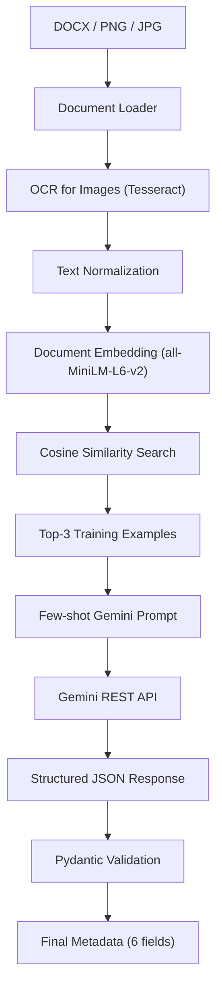

# AI-Powered Metadata Extraction from Rental Documents

This project automatically extracts **six key fields** from rental agreement documents.  
It supports **DOCX files** and **scanned images** (PNG, JPG).  
It uses OCR, semantic embeddings, document retrieval, and the **Gemini LLM** to produce structured JSON output — without any hardcoded field-specific rules.

---

## Table of Contents

1. [Problem Statement](#1-problem-statement)
2. [How It Works — Main Idea](#2-how-it-works--main-idea)
3. [Architecture Diagram](#3-architecture-diagram)
4. [Project Structure](#4-project-structure)
5. [Setup & Installation](#5-setup--installation)
6. [Configuration](#6-configuration)
7. [How to Run](#7-how-to-run)
8. [How Evaluation Works (LOOCV)](#8-how-evaluation-works-loocv)
9. [Results](#9-results)
10. [Running the Tests](#10-running-the-tests)
11. [Failure Categories & Known Limitations](#11-failure-categories--known-limitations)

---

## 1. Problem Statement

Rental agreements come in many different formats. They can have:

- Different page layouts and fonts
- Different wording for the same concept (e.g. "landlord" vs "lessor" vs "owner")
- Tables, multi-column layouts, or plain paragraphs
- Scanned images with OCR noise or character recognition errors
- Multiple dates on the same page (signing date, start date, end date)
- Multiple monetary values (advance, monthly rent, penalty clauses)
- Multiple people named in the document

The system must reliably extract exactly **six fields** from each document:

| Field | Description |
|---|---|
| `agreement_value` | The monthly rental amount |
| `agreement_start_date` | The date from which the agreement begins |
| `agreement_end_date` | The date on which the agreement ends |
| `renewal_notice_days` | Number of days notice required for renewal |
| `party_one` | First party (usually the landlord/owner) |
| `party_two` | Second party (usually the tenant) |

The system outputs a **structured JSON object** for every document:

```json
{
  "agreement_value": "8000",
  "agreement_start_date": "01.04.2011",
  "agreement_end_date": "31.03.2012",
  "renewal_notice_days": "90",
  "party_one": "K. Parthasarathy",
  "party_two": "Veerabrahmam Bathini"
}
```

Missing or unextractable fields return `null`.

---

## 2. How It Works — Main Idea

The pipeline runs the following steps for every document:

```
Document (DOCX / PNG / JPG)
        ↓
Document Loading
        ↓
OCR  (only if the document is an image)
        ↓
Text Normalization
        ↓
Text Embedding
        ↓
Retrieve similar training examples
        ↓
Build few-shot Gemini prompt
        ↓
Call Gemini REST API → Structured JSON
        ↓
Pydantic Validation
        ↓
Final Metadata (JSON)
```

### Step-by-step explanation

**Step 1 — Document Loading**  
The loader detects whether the file is a DOCX or an image.  
For DOCX files it extracts text from paragraphs and tables using `python-docx`.  
For image files (PNG/JPG) it passes the image to the OCR step.

**Step 2 — OCR (images only)**  
If the input is a scanned image, the pipeline pre-processes it (contrast enhancement, thresholding) using OpenCV and then runs **Tesseract OCR** to convert the image to text.

**Step 3 — Text Normalization**  
The raw text is cleaned: extra whitespace is collapsed, encoding artifacts are removed, and the text is made consistent for downstream steps.

**Step 4 — Text Embedding**  
The normalized text is converted to a **dense numerical vector** (embedding) using the `all-MiniLM-L6-v2` sentence-transformer model. Long documents are chunked into 2 000-character pieces with 200-character overlap, each piece is embedded, and then the embeddings are mean-pooled into a single document vector.

**Step 5 — Retrieve similar training examples**  
The document vector is compared via **cosine similarity** against all pre-indexed training documents. The **top-3 most similar** training documents are retrieved. These act as worked examples that guide the LLM.

**Step 6 — Build few-shot Gemini prompt**  
A prompt is constructed that includes:
- The text of the target document
- The top-3 retrieved training examples together with their known correct answers

This is called **few-shot prompting**: the model sees examples of correct extractions before being asked to extract from the new document.

**Step 7 — Gemini REST API call**  
The prompt is sent to the **Gemini REST API** (`/v1beta/models/{model}:generateContent`) over HTTPS using the `requests` library. The response is a JSON object using Gemini's native structured-output capability.

**Step 8 — Pydantic Validation**  
The raw JSON response is validated against the `MetadataExtraction` Pydantic schema to guarantee the correct field names and types. Invalid or missing fields become `null`.

**Step 9 — Final Metadata**  
The cleaned, validated dictionary is returned as the final result.

---

## 3. Architecture Diagram



---

## 4. Project Structure

```
project/
├── app/
│   ├── loaders/
│   │   ├── docx_loader.py      # Extracts text from .docx files
│   │   ├── image_loader.py     # OCR pipeline for PNG/JPG
│   │   ├── normalizer.py       # Text cleaning
│   │   └── base.py             # Base document dataclass
│   ├── retrieval/
│   │   ├── embeddings.py       # Sentence-transformer embedding model
│   │   ├── retriever.py        # Cosine similarity index (search + save)
│   │   └── training_data.py    # Loads train.csv metadata
│   ├── llm/
│   │   ├── provider.py         # GeminiRESTProvider + MockProvider
│   │   └── extractor.py        # Builds the few-shot extraction prompt
│   ├── pipeline.py             # Main extraction pipeline (orchestrator)
│   ├── schemas.py              # Pydantic schema: MetadataExtraction
│   └── main.py                 # FastAPI skeleton (health check only)
│
├── scripts/
│   ├── build_index.py          # Builds the semantic retrieval index
│   ├── predict.py              # Runs the pipeline on a single document
│   ├── loocv.py                # Leave-One-Out Cross-Validation experiment
│   └── evaluate.py             # Exact-match evaluation from CSV files
│
├── data/
│   ├── train/                  # Training documents (DOCX / image)
│   ├── train.csv               # Ground-truth labels for training documents
│   ├── test/                   # Test documents
│   └── test.csv                # Ground-truth labels for test documents
│
├── artifacts/
│   ├── retrieval_index/        # Saved embedding index (created by build_index.py)
│   ├── loocv/                  # LOOCV output files
│   │   ├── metrics.json
│   │   ├── predictions.json
│   │   ├── detailed_results.json
│   │   └── error_analysis.md
│   └── debug/
│       └── example_prompt.txt  # Last prompt sent to Gemini (for debugging)
│
├── tests/                      # Unit tests (pytest)
├── requirements.txt
├── pytest.ini
└── .env.example
```

---

## 5. Setup & Installation

### System requirements

- Python **3.10+**
- **Tesseract OCR** (system package, required for image documents)

```bash
# Ubuntu / Debian
sudo apt install tesseract-ocr tesseract-ocr-eng

# macOS (Homebrew)
brew install tesseract
```

### Install Python dependencies

```bash
# Clone the repository
git clone <your-repo-url>
cd project

# Create and activate a virtual environment (recommended)
python3 -m venv .venv
source .venv/bin/activate

# Install all dependencies
pip install -r requirements.txt
```

---

## 6. Configuration

Copy `.env.example` to `.env` and fill in your values:

```bash
cp .env.example .env
```

Edit `.env`:

```env
# Required — your Gemini API key from Google AI Studio
GEMINI_API_KEY=your-api-key-here

# Optional — Gemini model to use (default: gemini-2.5-flash)
GEMINI_MODEL=gemini-2.5-flash

# Required — must be set to "gemini" to use the real Gemini provider
LLM_PROVIDER=gemini
```

> **Where to get a Gemini API key:**  
> Visit [aistudio.google.com](https://aistudio.google.com/) → click "Get API Key" → create a new key.

> **Note:** The free tier has a rate limit of ~5 requests/minute and 20 requests/day per model. The LOOCV script automatically paces requests to stay within these limits.

---

## 7. How to Run

### Step 1 — Build the retrieval index

This must be run **once** before any predictions. It reads all training documents, embeds them, and saves the index to `artifacts/retrieval_index/`.

```bash
python scripts/build_index.py
```

Expected output:
```
================================================================================
 BUILDING SEMANTIC RETRIEVAL INDEX
================================================================================
...
 Documents indexed : 9
 Embedding model   : all-MiniLM-L6-v2
 Embedding dim     : 384
 Index path        : .../artifacts/retrieval_index
```

### Step 2 — Run a prediction on one document

```bash
python scripts/predict.py --file data/train/your-document.docx
```

Or for an image:

```bash
python scripts/predict.py --file data/train/your-document.png
```

Example output:

```
================================================================================
 PREDICTION PIPELINE
================================================================================

DOCUMENT : /path/to/your-document.docx

PROVIDER : GeminiRESTProvider (model: gemini-2.5-flash)

────────────────────────────────────────────────────────────────────────────────
 RETRIEVED EXAMPLES
────────────────────────────────────────────────────────────────────────────────
1. 50070534-RENTAL-AGREEMENT — similarity: 0.8220
2. 54945838-Rental-Agreement — similarity: 0.7989
3. 47854715-RENTAL-AGREEMENT — similarity: 0.7710

────────────────────────────────────────────────────────────────────────────────
 PREDICTION
────────────────────────────────────────────────────────────────────────────────
{
  "agreement_value": "4000",
  "agreement_start_date": "01.11.2008",
  "agreement_end_date": "31.10.2009",
  "renewal_notice_days": "30",
  "party_one": "K.V. Rajan",
  "party_two": "P.M. Narayana Namboodri"
}

────────────────────────────────────────────────────────────────────────────────
 VALIDATION
────────────────────────────────────────────────────────────────────────────────
 PASS — all fields match MetadataExtraction schema.

────────────────────────────────────────────────────────────────────────────────
 API CALLS MADE: 1
================================================================================
```

---

## 8. How Evaluation Works (LOOCV)

The project uses **Leave-One-Out Cross-Validation (LOOCV)** to measure extraction quality on the training set without using a separate test set.

### What is LOOCV?

With 9 available training documents:

- **Fold 1**: Hold out document 1 → train on documents 2–9 → predict on document 1
- **Fold 2**: Hold out document 2 → train on documents 1, 3–9 → predict on document 2
- … and so on for all 9 documents

At each fold:
1. The held-out document is **strictly excluded** from the retrieval index
2. The pipeline predicts the 6 fields for the held-out document using only the other 8 as examples
3. Each predicted field is compared against the ground truth using **exact string match**

The script **programmatically verifies** that the held-out document never appears in the retrieved examples (self-retrieval prevention).

### Run LOOCV

```bash
GEMINI_API_KEY=your-key LLM_PROVIDER=gemini GEMINI_MODEL=gemini-2.5-flash \
    python scripts/loocv.py
```

> **Rate limit note:** The free-tier Gemini API allows ~5 requests/minute. The script automatically waits 13 seconds between folds. The full LOOCV run takes approximately 3–4 minutes.

### LOOCV Output artifacts

After the run, four files are saved to `artifacts/loocv/`:

| File | Contents |
|---|---|
| `metrics.json` | Per-field recall and macro-average recall |
| `predictions.json` | All predicted values for every held-out document |
| `detailed_results.json` | Per-document field-by-field match/fail results |
| `error_analysis.md` | Human-readable breakdown of every incorrect prediction |

---

## 9. Results

The following results were measured using **LOOCV over 9 training documents** with the **Gemini REST provider** (`gemini-3.5-flash-lite`).

### Metric: Exact-Match Recall per Field

| Field | Correct | Total | Recall |
|---|---|---|---|
| `agreement_value` | 4 | 9 | **44.4%** |
| `agreement_start_date` | 6 | 9 | **66.7%** |
| `agreement_end_date` | 3 | 9 | **33.3%** |
| `renewal_notice_days` | 6 | 9 | **66.7%** |
| `party_one` | 4 | 9 | **44.4%** |
| `party_two` | 3 | 9 | **33.3%** |
| **Macro-average** | — | — | **48.1%** |

### Experiment statistics

| Metric | Value |
|---|---|
| Total API calls | 9 |
| Successful calls | 9 |
| Failed calls | 0 |
| Invalid JSON responses | 0 |
| Self-retrieval violations | 0 |
| Pytest tests passing | 61 / 61 |

### Why exact-match is strict

The evaluation uses **case-sensitive exact string match**. This means:
- `"P C MATHEW"` ≠ `"P C Mathew"` → counted as **wrong**
- `"4000"` ≠ `"4000.00"` → counted as **wrong**
- `"Balaji.R"` ≠ `"Mr. Balaji.R"` → counted as **wrong**

Relaxed matching (e.g. case-insensitive, normalized whitespace) would produce higher numbers.

---

## 10. Running the Tests

The test suite covers the LLM provider, document loaders, and retrieval components. All tests run **fully offline** — no real API calls are made.

```bash
# Run all tests
python -m pytest

# Run with verbose output
python -m pytest -v

# Run only LLM tests
python -m pytest tests/test_llm.py -v
```

Expected result: **61 passed**

---

## 11. Failure Categories & Known Limitations

Analysis of incorrect predictions reveals four main failure patterns:

### 1. Party identification ambiguity
The model sometimes includes or omits honorifics.  
Example: Expected `"Balaji.R"`, predicted `"Mr. Balaji.R"`.

### 2. Multiple dates in the same document
When a document contains both an execution date and a commencement date, the model sometimes picks the wrong one.  
Example: Expected `"01.04.2011"`, predicted `"20.04.2011"`.

### 3. Multiple monetary values
Documents often contain advance payment, monthly rent, and penalty clauses. The model may select a different monetary value.  
Example: Expected `"3800"`, predicted `"38000"` (digit recognition error from OCR noise).

### 4. OCR noise propagation
For heavily degraded scans, OCR output may contain garbled characters. These errors propagate through the entire pipeline.  
Example: Expected `"M.V.V. VIJAYA SHANKAR"`, predicted `"M. V, V« VI JAY A SHANKAR"`.

### Missing training document
One document (`24158401-Rental-Agreement`) is listed in `train.csv` but the file is missing from `data/train/`. This reduces the effective training pool from 10 to 9 documents.

---

## Environment Variables Reference

| Variable | Required | Default | Description |
|---|---|---|---|
| `GEMINI_API_KEY` | **Yes** | — | Gemini API key from Google AI Studio |
| `GEMINI_MODEL` | No | `gemini-2.5-flash` | Gemini model name |
| `LLM_PROVIDER` | No | `mock` | Set to `gemini` to use real Gemini |
| `LLM_TEMPERATURE` | No | `0.0` | Sampling temperature for the LLM |

---

## Quick Start Summary

```bash
# 1. Install system dependency
sudo apt install tesseract-ocr tesseract-ocr-eng

# 2. Install Python packages
pip install -r requirements.txt

# 3. Set your API key
echo "GEMINI_API_KEY=your-key-here" > .env
echo "LLM_PROVIDER=gemini" >> .env

# 4. Build retrieval index
python scripts/build_index.py

# 5. Run prediction on a document
python scripts/predict.py --file data/train/your-document.docx

# 6. Run LOOCV evaluation
python scripts/loocv.py

# 7. Run tests
python -m pytest
```
